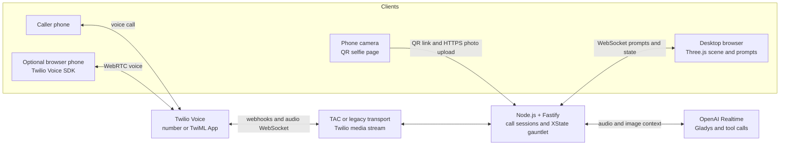

# Universal Help Care: Project Overview

## What it does

Universal Help Care is a deliberately overcomplicated support line. A caller phones the help desk and meets
Gladys, a dry, bureaucratic voice agent. Before the caller can get anywhere, the app asks them to pass a small
gauntlet while a desktop browser shows the current challenge in a three-dimensional solar system:

1. **Pairing:** read a short code from the desktop screen so the call is linked to the right browser session.
2. **Language:** say a phrase in another language; Gladys judges the attempt.
3. **Selfie:** scan a one-time QR code with a phone camera and submit a photo that meets the current requirement.
   The app sends the image to the voice agent for review.
4. **Humanity check:** answer a fashion-trivia question shown alongside a related image.
5. **Opus 1:** reach the final hold stage, where the caller is sent to hold music. **Ticket filing is currently
   disabled**; the app does not yet save a support request.

The server controls the stage order and decides whether a check can advance. The voice model talks with the caller
and reports its judgments through server-defined tools; it cannot skip ahead by changing browser state directly.

## Technology

| Area | Technology | Role |
| --- | --- | --- |
| Runtime | Node.js 22+, TypeScript, npm workspaces | Runs the server and builds the browser app from one repository. |
| HTTP and WebSockets | Fastify, `@fastify/websocket` | Serves API routes, Twilio webhooks, media streams, and the desktop session socket. |
| Call provider | Twilio Programmable Voice | Receives phone calls and carries audio between the caller and the app. |
| Voice transport | Twilio Agent Connect (TAC), with a `legacy` option | TAC handles Twilio voice integration when `VOICE_TRANSPORT=tac`; the legacy transport remains available. Both use the app's voice-call logic. |
| Browser phone | Twilio Voice JavaScript SDK | Optional access-code-protected Production softphone using the computer's microphone and speakers. |
| Voice agent | OpenAI Agents SDK Realtime and OpenAI Realtime | Streams audio, speaks as Gladys, calls server tools, and reviews selfie images. |
| Call workflow | XState | Enforces the ordered verification stages and their retry/terminal states. |
| Web interface | TypeScript, Vite, Three.js | Displays the planetary scene, prompts, QR code, photos, and ticket panel. |
| Shared messages | `shared/protocol.ts` | Defines the typed events exchanged between the server and browser. |
| Hosting | Railway or another long-running Node host; ngrok for local webhook testing | Keeps the HTTP and WebSocket server reachable by Twilio. |

The app has no database. Call sessions, uploaded selfies, and any in-memory ticket data are lost when the server
restarts. The current final hold stage does not create a ticket.

## Simple system design

## Main runtime flow

1. The desktop browser opens a session. The server generates a short pairing code and sends the screen state over a
   WebSocket.
2. A phone call—or the optional browser phone—reaches Twilio. Twilio sends a webhook to the server and opens a
   bidirectional audio stream. TAC or the legacy transport connects that stream to the existing call handler.
3. The call handler starts an OpenAI Realtime session. Gladys speaks and uses tools to ask the server to pair the
   caller, show each challenge, and submit its result.
4. The server advances the XState workflow and pushes prompts and results to the matching desktop session.
5. For the selfie check, the browser shows a one-time QR link. The phone uploads its photo over HTTPS; the server
   passes the image to the Realtime session and displays it on the desktop.
6. At the final stage, the app redirects the call to hold music and ends the voice session. It does not currently
   persist or file a support ticket.

## Deployment notes

- **Local:** run the Node server and expose its webhook/WebSocket address with ngrok. Twilio must be able to reach
  the public HTTPS URL.
- **Production:** deploy `main` to the single Railway Production environment with `VOICE_TRANSPORT=tac`. The browser phone is separately gated by
  `ENABLE_DEV_PHONE`, a TwiML App SID, and a private access code; disable it when browser-phone testing is finished.
- **Production suitability:** the server needs a stable public HTTPS endpoint and long-lived WebSocket support.
- **Cost and safety:** Twilio call minutes and OpenAI Realtime usage are billable. Keep caller restrictions,
  concurrency and call-duration limits configured for any publicly reachable deployment.
